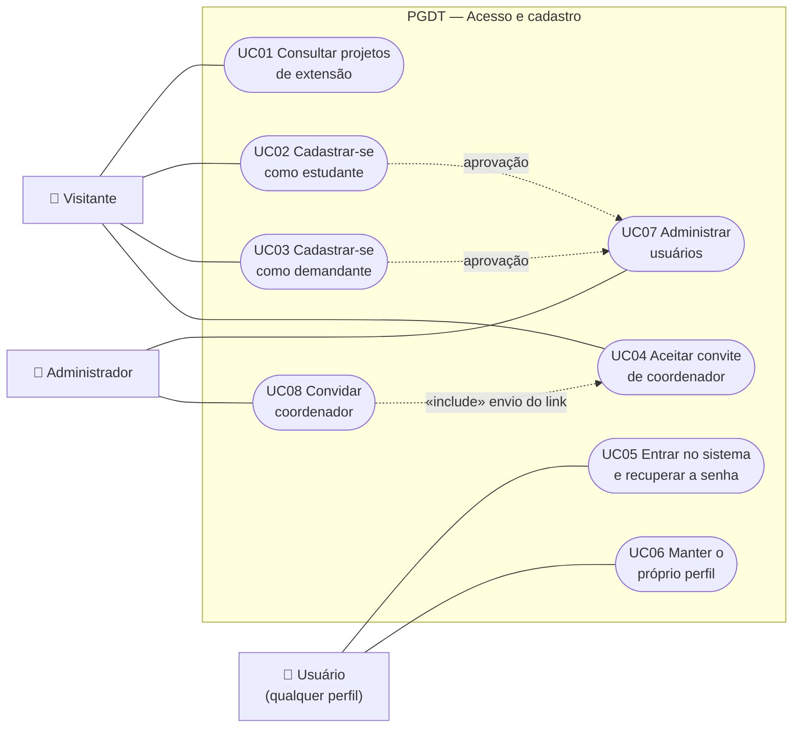
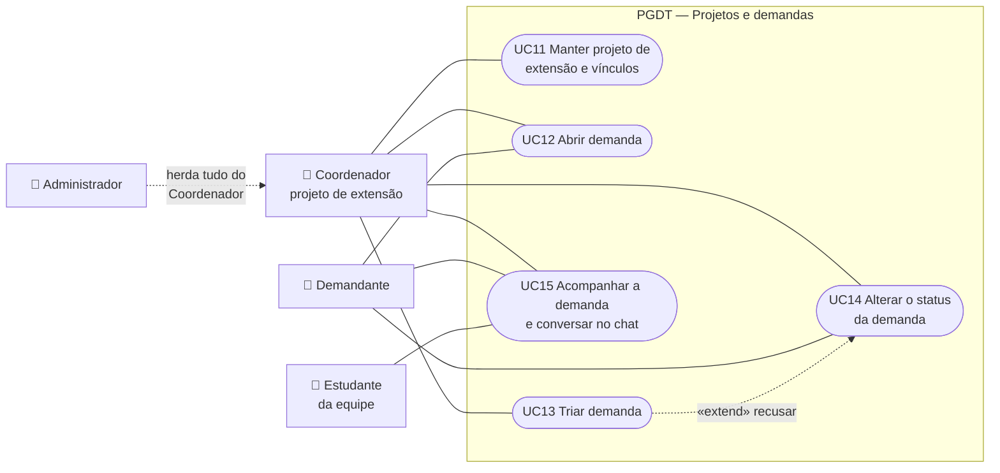
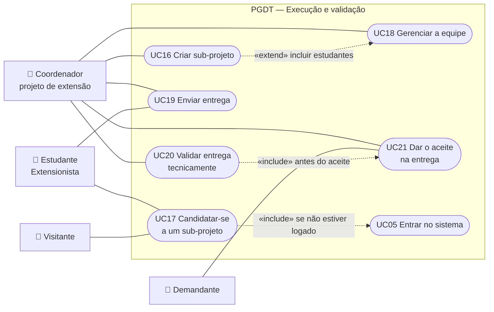
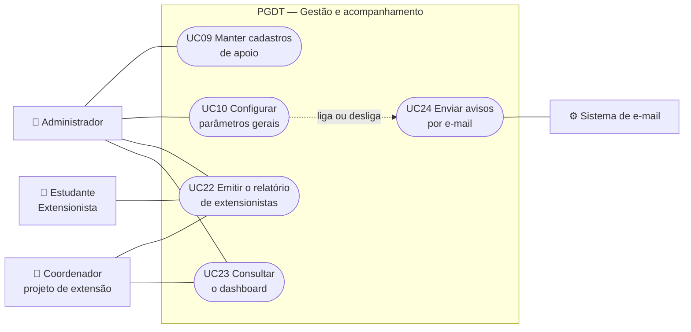

# Casos de uso — PGDT

Plataforma de Gestão de Demandas Tecnológicas, do projeto de extensão "Rede de Apoio Tecnológico às Escolas" (UFES/CCENS — Alegre-ES).

Os casos de uso descrevem o sistema como está implementado (novembro de 2026) e usam a numeração dos requisitos de [`REQUISITOS.md`](REQUISITOS.md). Os diagramas estão em [Mermaid](https://mermaid.js.org/): o GitHub mostra os desenhos nesta página, e o [Mermaid Live Editor](https://mermaid.live) exporta cada um em PNG ou SVG para o TCC.

---

## 1. Atores

| Ator | Quem é | Como entra no sistema |
|---|---|---|
| **Visitante** | Qualquer pessoa sem login | — |
| **Estudante Extensionista** | Aluno da UFES que participa das equipes | Autocadastro com e-mail `@edu.ufes.br` e aprovação do admin |
| **Demandante** | Representante de uma escola ou instituição da comunidade | Autocadastro e aprovação do admin |
| **Coordenador projeto de extensão** | Professor que coordena um projeto de extensão | Convite do admin |
| **Administrador** | Responsável pela plataforma | Criado na instalação ou pelo painel |
| **Sistema de e-mail** | Ator secundário: a fila que envia os avisos | — |

**Generalização:** o Administrador pode fazer tudo o que o Coordenador faz, em qualquer projeto. Estudante, Demandante, Coordenador e Administrador são usuários e compartilham o UC05 e o UC06.

## 2. Lista de casos de uso

| UC | Caso de uso | Atores | RF |
|---|---|---|---|
| UC01 | Consultar projetos de extensão | Visitante (e usuários logados) | RF14 |
| UC02 | Cadastrar-se como estudante | Visitante | RF01 |
| UC03 | Cadastrar-se como demandante | Visitante | RF02 |
| UC04 | Aceitar convite de coordenador | Visitante convidado | RF16 |
| UC05 | Entrar no sistema e recuperar a senha | Usuários | RF03 |
| UC06 | Manter o próprio perfil | Usuários | RF21 |
| UC07 | Administrar usuários | Administrador | RF04 |
| UC08 | Convidar coordenador | Administrador | RF16 |
| UC09 | Manter cadastros de apoio | Administrador | RF17 |
| UC10 | Configurar parâmetros gerais | Administrador | RF20 |
| UC11 | Manter projeto de extensão e vínculos | Coordenador, Administrador | RF05, RF22 |
| UC12 | Abrir demanda | Demandante, Coordenador, Administrador | RF06 |
| UC13 | Triar demanda | Coordenador, Administrador | RF07 |
| UC14 | Alterar o status da demanda | Coordenador, Administrador, Demandante (só cancelar) | RF07, RF08, RF13 |
| UC15 | Acompanhar a demanda e conversar no chat | Demandante, Coordenador, Administrador, Estudante da equipe | RF08 |
| UC16 | Criar sub-projeto | Coordenador, Administrador | RF09 |
| UC17 | Candidatar-se a um sub-projeto | Estudante | RF10, RF14 |
| UC18 | Gerenciar a equipe | Coordenador, Administrador | RF11 |
| UC19 | Enviar entrega | Estudante da equipe, Coordenador, Administrador | RF12 |
| UC20 | Validar entrega tecnicamente | Coordenador, Administrador | RF13 |
| UC21 | Dar o aceite na entrega | Demandante (ou a coordenação em nome dele) | RF13 |
| UC22 | Emitir o relatório de extensionistas | Estudante, Coordenador, Administrador | RF15 |
| UC23 | Consultar o dashboard | Coordenador, Administrador | RF18 |
| UC24 | Enviar avisos por e-mail | Sistema de e-mail | RF19 |

---

## 3. Diagramas de casos de uso

Os casos de uso estão divididos em quatro áreas, para cada figura ficar legível. Atores ficam fora do retângulo do sistema; as elipses são os casos de uso.

### 3.1 Acesso e cadastro

### 3.2 Projetos e demandas

### 3.3 Execução e validação

### 3.4 Gestão e acompanhamento

---

## 4. Especificação dos casos de uso

Cada caso traz os atores, o requisito, as condições antes e depois e os fluxos. "FA" são os fluxos alternativos e de exceção.

### UC01 - Consultar projetos de extensão
- **Atores:** Visitante; também usuários logados. **RF:** RF14.
- **Pré-condição:** nenhuma.
- **Fluxo principal:**
  1. O visitante abre "Projetos e vagas" (`/projetos`).
  2. O sistema lista os projetos de extensão públicos e ativos, em cartões com imagem.
  3. O visitante pesquisa ou filtra e abre um projeto.
  4. O sistema mostra a descrição, o coordenador e os sub-projetos com vagas abertas (título, escopo, modalidade, período e vagas).
  5. O visitante clica em "Quero participar" e segue para o UC17.
- **FA1 – Sem vagas:** o projeto aparece sem sub-projetos com vagas, com uma mensagem.
- **Pós-condição:** nenhum dado é alterado. Contatos, anexos, chat e fotos de usuários não aparecem.

### UC02 - Cadastrar-se como estudante
- **Ator:** Visitante. **RF:** RF01.
- **Pré-condição:** ter e-mail `@edu.ufes.br`.
- **Fluxo principal:**
  1. O visitante clica em "Criar conta" e escolhe "Sou estudante da UFES".
  2. Preenche nome, e-mail, matrícula, curso, telefone (opcional), senha e confirmação.
  3. O sistema valida os dados, cria a conta "Pendente" com o perfil Estudante e envia o link de confirmação de e-mail.
  4. O estudante abre o link; o sistema confirma o e-mail e mostra "Cadastro em análise".
  5. O administrador aprova o cadastro (UC07), e o estudante recebe o aviso por e-mail.
- **FA1 – E-mail de fora da UFES:** o sistema recusa e oferece o cadastro de demandante.
- **FA2 – Matrícula ou e-mail já cadastrados:** o sistema mostra o erro junto do campo.
- **FA3 – Cadastro rejeitado:** o estudante recebe o motivo por e-mail e não consegue entrar.
- **Pós-condição:** conta de estudante "Ativo", depois da aprovação.

### UC03 - Cadastrar-se como demandante
- **Ator:** Visitante. **RF:** RF02.
- **Pré-condição:** nenhuma.
- **Fluxo principal:**
  1. O visitante clica em "Criar conta" e escolhe "Represento uma escola ou instituição".
  2. Preenche nome, e-mail, escola (da lista), cargo, telefone, senha e confirmação.
  3. O sistema cria a conta "Pendente" com o perfil Demandante e mostra "Cadastro em análise".
  4. O administrador aprova o cadastro (UC07), e o demandante recebe o aviso por e-mail.
- **FA1 – Escola não está na lista:** o visitante escolhe "Não encontrei minha escola" e digita nome, tipo, cidade e UF. A escola nova fica inativa até o admin conferir, junto com a aprovação.
- **FA2 – E-mail da UFES:** o sistema pergunta se a pessoa quer se cadastrar como estudante; ela pode continuar como demandante.
- **FA3 – Cadastro rejeitado:** o demandante recebe o motivo por e-mail.
- **Pós-condição:** conta de demandante "Ativo", depois da aprovação.

### UC04 - Aceitar convite de coordenador
- **Ator:** Visitante convidado. **RF:** RF16.
- **Pré-condição:** ter recebido o convite (UC08).
- **Fluxo principal:**
  1. O convidado abre o link do e-mail.
  2. O sistema confere o link e mostra o formulário.
  3. O convidado preenche nome, telefone, SIAPE e departamento (opcionais) e a senha.
  4. O sistema cria a conta "Ativo" com o perfil Coordenador, marca o convite como usado e entra no sistema.
- **FA1 – Link vencido, usado, cancelado ou substituído:** o sistema explica e não deixa criar a conta.
- **FA2 – SIAPE já cadastrado:** erro junto do campo.
- **Pós-condição:** coordenador ativo; o convite não pode ser usado de novo.

### UC05 - Entrar no sistema e recuperar a senha
- **Atores:** Estudante, Demandante, Coordenador, Administrador. **RF:** RF03.
- **Pré-condição:** ter uma conta.
- **Fluxo principal:**
  1. O usuário informa e-mail e senha na tela de login única.
  2. O sistema autentica e abre o painel e o menu do perfil da conta.
- **FA1 – Esqueci a senha:** o usuário informa o e-mail e recebe um link válido por 60 minutos. Ele define a nova senha e entra.
- **FA2 – Conta "Pendente":** o usuário vê só a tela "Cadastro em análise".
- **FA3 – Conta "Inativa" ou "Rejeitada":** o sistema não deixa entrar e mostra o motivo.
- **FA4 – 5 tentativas erradas:** o login fica bloqueado por alguns minutos.
- **FA5 – Veio do "Quero participar" (UC17):** depois do login, o sistema volta para o sub-projeto.
- **Pós-condição:** sessão aberta com as permissões do perfil.

### UC06 - Manter o próprio perfil
- **Atores:** usuários com conta ativa. **RF:** RF21.
- **Pré-condição:** estar logado.
- **Fluxo principal:**
  1. O usuário abre "Meu perfil".
  2. Altera nome, telefone e os dados do seu perfil (curso, cargo ou SIAPE e departamento) e salva.
- **FA1 – Foto:** o usuário envia uma imagem. O sistema recorta em quadrado, regrava sem os dados ocultos e mostra a foto no menu, no chat e na equipe. Ele também pode remover a foto.
- **FA2 – Senha:** o usuário informa a senha atual e a nova.
- **Pós-condição:** dados atualizados. E-mail, perfil, status, matrícula e escola só mudam pelo administrador.

### UC07 - Administrar usuários
- **Ator:** Administrador. **RF:** RF04.
- **Pré-condição:** estar logado como administrador.
- **Fluxo principal:**
  1. O admin abre "Usuários" e filtra por nome, e-mail, perfil ou status.
  2. Abre um usuário "Pendente", confere os dados (e a escola nova, se houver) e aprova.
  3. O sistema ativa a conta e avisa a pessoa por e-mail.
- **FA1 – Rejeitar ou inativar:** o admin informa o motivo e confirma. A pessoa não entra mais e vê o motivo.
- **FA2 – Reativar:** o admin muda o status para "Ativo".
- **FA3 – Trocar o perfil:** o sistema mostra o perfil atual e o novo e pede os dados do novo perfil. Se a pessoa coordena projetos, o sistema avisa quantos projetos e sub-projetos passam para a administração.
- **FA4 – Corrigir dados:** em "Editar dados", o admin corrige nome, telefone e os dados do perfil, sem trocá-lo.
- **Pós-condição:** conta no status e no perfil escolhidos, com o registro de quem aprovou.

### UC08 - Convidar coordenador
- **Ator:** Administrador. **RF:** RF16.
- **Pré-condição:** estar logado como administrador.
- **Fluxo principal:**
  1. O admin abre "Convites" e informa o e-mail.
  2. O sistema cria o convite com validade de 7 dias e envia o link.
- **FA1 – Já havia convite para o e-mail:** o anterior fica "Substituído".
- **FA2 – Cancelar:** o admin cancela um convite válido, que fica "Cancelado".
- **Pós-condição:** convite "Válido" até ser usado, vencer ou ser encerrado.

### UC09 - Manter cadastros de apoio
- **Ator:** Administrador. **RF:** RF17.
- **Fluxo principal:**
  1. O admin abre "Configurações" → "Cadastros de apoio" e escolhe a lista (tipologias, categorias, prioridades ou papéis da equipe).
  2. Inclui um item, renomeia ou ativa/inativa.
- **FA1 – Prioridade:** o admin também define a ordem de atendimento.
- **Pós-condição:** nenhum item é apagado. O item inativado sai das listas de escolha, mas continua nos registros que já o usam.

### UC10 - Configurar parâmetros gerais
- **Ator:** Administrador. **RF:** RF20.
- **Fluxo principal:**
  1. O admin abre "Configurações" → "Parâmetros gerais".
  2. Altera o nome da rede, o e-mail de contato, os avisos por e-mail e os limites de arquivos.
  3. O sistema confere os limites do servidor e salva, com o registro de quem alterou.
- **FA1 – Limite acima do servidor:** o sistema recusa e mostra o limite permitido.
- **Pós-condição:** os novos valores valem para todo o sistema.

### UC11 - Manter projeto de extensão e vínculos
- **Atores:** Coordenador, Administrador. **RF:** RF05, RF22.
- **Pré-condição:** estar logado como coordenador ou administrador.
- **Fluxo principal:**
  1. O coordenador abre "Projetos Base" → "Novo projeto".
  2. Preenche título, descrição, escopo preliminar, datas, tipologia, imagem (opcional) e as chaves "Ativo" e "Público".
  3. Marca os estudantes extensionistas vinculados.
  4. O sistema salva o projeto com o coordenador como responsável.
- **FA1 – Editar:** o coordenador edita só os projetos que coordena; o admin edita todos e escolhe o coordenador.
- **FA2 – Encerrar o projeto:** desmarcar "Ativo" tira o projeto da abertura de demandas, sem apagá-lo.
- **FA3 – Desvincular estudante:** ele deixa de entrar em novas equipes, mas continua nas atuais.
- **Pós-condição:** projeto disponível para demandas e, se público, no UC01.

### UC12 - Abrir demanda
- **Atores:** Demandante, Coordenador, Administrador. **RF:** RF06.
- **Pré-condição:** existir um projeto de extensão ativo.
- **Fluxo principal (demandante):**
  1. O demandante abre "Minhas demandas" → "Nova demanda".
  2. Escolhe o projeto de extensão e preenche título, descrição, justificativa e público afetado.
  3. Anexa arquivos, se quiser, arrastando para a área de envio.
  4. O sistema confere os arquivos, grava a demanda como "Cadastrada" com a escola do demandante e registra a abertura na linha do tempo.
  5. O sistema avisa a coordenação do projeto por e-mail (UC24).
- **FA1 – Aberta pela coordenação:** o coordenador (nos seus projetos) ou o admin escolhe a escola e o demandante que acompanha, os dois opcionais. A linha do tempo registra em nome de quem a demanda foi aberta, e o demandante indicado recebe um aviso.
- **FA2 – Arquivo inválido:** o sistema recusa o arquivo (tipo, tamanho ou quantidade) e cita o nome dele.
- **Pós-condição:** demanda "Cadastrada" na fila da coordenação.

### UC13 - Triar demanda
- **Atores:** Coordenador, Administrador. **RF:** RF07.
- **Pré-condição:** demanda "Cadastrada", "Em Análise" ou "Priorizada".
- **Fluxo principal:**
  1. O coordenador abre "Demandas"; a fila mostra as cadastradas, ordenadas por prioridade e data.
  2. Abre a demanda, lê os dados e os anexos e muda o status para "Em Análise" (UC14).
  3. Define categoria, prioridade e complexidade e salva.
  4. O sistema grava quem classificou e quando, e registra na linha do tempo.
  5. O coordenador muda o status para "Priorizada" (UC14).
- **FA1 – Demanda não viável:** o coordenador recusa a demanda com motivo (UC14).
- **FA2 – Rever a classificação:** possível até "Priorizada"; a linha do tempo mostra só o que mudou.
- **Pós-condição:** demanda classificada e priorizada.

### UC14 - Alterar o status da demanda
- **Atores:** Coordenador, Administrador; Demandante só para cancelar. **RF:** RF07, RF08, RF13.
- **Pré-condição:** o status atual permite a mudança (ver o ciclo de status em [`FLUXOGRAMA.md`](FLUXOGRAMA.md)).
- **Fluxo principal:**
  1. Na tela da demanda, o sistema mostra só os próximos status possíveis e sugere um (ex.: "Entrega recebida. Mudar para Em Validação?").
  2. O coordenador escolhe o status e confirma.
  3. O sistema grava a mudança na linha do tempo, com quem mudou, e avisa o demandante e a equipe (UC24).
- **FA1 – Recusar ou cancelar:** o motivo é obrigatório, e o demandante o vê.
- **FA2 – Cancelamento pelo demandante:** só com a demanda "Cadastrada", "Em Análise" ou "Priorizada".
- **FA3 – Concluir sem entrega aceita:** o sistema não oferece "Concluída". Se houver entregas em avaliação, avisa antes de concluir.
- **FA4 – Concluída ou recusada:** o admin não pode cancelar.
- **Pós-condição:** demanda no novo status, com o registro na linha do tempo.

### UC15 - Acompanhar a demanda e conversar no chat
- **Atores:** Demandante da demanda, Coordenador, Administrador, Estudante da equipe. **RF:** RF08.
- **Pré-condição:** estar envolvido na demanda.
- **Fluxo principal:**
  1. O usuário abre a demanda e vê a barra de progresso e o último registro da linha do tempo.
  2. Abre a linha do tempo completa numa janela, se quiser.
  3. Escreve uma mensagem no chat e clica em "Enviar Comentário".
  4. O sistema grava a mensagem com autor, perfil e data/hora e avisa os demais participantes (UC24).
- **FA1 – Demanda concluída ou cancelada:** o chat fica só para leitura.
- **FA2 – Estudante da equipe:** não vê o e-mail e o telefone do demandante.
- **Pós-condição:** mensagem registrada; não pode ser editada nem apagada.

### UC16 - Criar sub-projeto
- **Atores:** Coordenador, Administrador. **RF:** RF09.
- **Pré-condição:** demanda "Priorizada" e ainda sem sub-projeto.
- **Fluxo principal:**
  1. Na demanda, o coordenador clica em "Criar sub-projeto".
  2. O sistema preenche título e escopo com os dados da demanda.
  3. O coordenador ajusta o escopo e informa datas, carga horária estimada, vagas, modalidade e "Receber candidaturas".
  4. O sistema cria o sub-projeto com o coordenador como responsável, registra na linha do tempo e sugere "Em Desenvolvimento" (UC14).
- **FA1 – Incluir estudantes:** o coordenador escolhe estudantes vinculados ao projeto e o papel deles, que entram direto na equipe (UC18).
- **FA2 – Criado pelo admin:** o responsável é o coordenador do projeto de extensão.
- **FA3 – Corrigir depois do encerramento:** só a carga horária e a data de término, com registro dos valores anterior e novo.
- **Pós-condição:** sub-projeto na vitrine (UC17), se houver vagas e a chave estiver marcada.

### UC17 - Candidatar-se a um sub-projeto
- **Ator:** Estudante (o Visitante começa pelo UC01). **RF:** RF10, RF14.
- **Pré-condição:** estudante ativo e vinculado ao projeto de extensão; sub-projeto com vagas e recebendo candidaturas.
- **Fluxo principal:**
  1. O estudante abre "Oportunidades", pesquisa e filtra por modalidade e projeto.
  2. Abre um sub-projeto e clica em "Confirmar candidatura".
  3. O sistema registra a candidatura "Pendente" e avisa a coordenação (UC24).
- **FA1 – Veio da página pública sem login:** "Quero participar" leva ao login (UC05) e volta ao sub-projeto.
- **FA2 – Não pode se inscrever:** o botão aparece desabilitado com o motivo (conta não ativa, sem vínculo com o projeto, já participou da equipe).
- **FA3 – Desistir:** o estudante cancela a candidatura enquanto ela não foi avaliada e pode se candidatar de novo.
- **Pós-condição:** candidatura pendente, acompanhada em "Meus sub-projetos".

### UC18 - Gerenciar a equipe
- **Atores:** Coordenador, Administrador. **RF:** RF11.
- **Pré-condição:** sub-projeto de uma demanda em andamento.
- **Fluxo principal:**
  1. Na tela do sub-projeto, o coordenador vê as candidaturas pendentes.
  2. Aprova uma candidatura escolhendo o papel.
  3. O sistema confere as vagas e o vínculo, coloca o estudante na equipe, registra na linha do tempo e avisa o estudante.
- **FA1 – Recusar:** o coordenador informa um motivo (opcional), e o estudante é avisado.
- **FA2 – Trocar papel ou remover membro:** com confirmação. O membro removido não é apagado e pode ser incluído de novo.
- **FA3 – Sem vagas:** o sistema não aprova e pede para aumentar as vagas.
- **FA4 – Estudante sem vínculo:** a candidatura aparece marcada, e o sistema pede para vincular ou recusar.
- **Pós-condição:** equipe atualizada. Com a equipe completa, o sub-projeto sai da vitrine.

### UC19 - Enviar entrega
- **Atores:** Estudante da equipe; Coordenador e Administrador em nome da equipe. **RF:** RF12.
- **Pré-condição:** demanda "Em Desenvolvimento", "Em Validação" ou "Aguardando Ajustes".
- **Fluxo principal:**
  1. Na tela do sub-projeto, o membro clica em "Nova entrega".
  2. Escolhe o tipo (link, relatório técnico ou arquivos/fotos) e preenche título e descrição.
  3. Informa o link ou anexa os arquivos.
  4. O sistema confere os arquivos pelo conteúdo, numera a entrega, registra na linha do tempo e avisa a coordenação (UC24).
  5. O sistema sugere "Em Validação" à coordenação (UC14).
- **FA1 – Arquivo ou link inválido:** o sistema recusa e explica.
- **FA2 – Enviada pela coordenação:** a linha do tempo indica "enviada pela coordenação em nome da equipe".
- **Pós-condição:** entrega "Aguardando validação técnica".

### UC20 - Validar entrega tecnicamente
- **Atores:** Coordenador, Administrador. **RF:** RF13 (etapa 1).
- **Pré-condição:** entrega aguardando a validação técnica.
- **Fluxo principal:**
  1. O coordenador abre a entrega e confere o conteúdo e os arquivos.
  2. Clica em "Aprovar Tecnicamente".
  3. O sistema registra a decisão, libera a entrega para o demandante e o avisa (UC24).
- **FA1 – Devolver para Ajustes:** o comentário é obrigatório. A entrega volta para a equipe, que é avisada.
- **FA2 – Decisão repetida (duplo clique, duas abas):** o sistema avisa que a entrega já foi avaliada e não grava de novo.
- **Pós-condição:** entrega aguardando o aceite ou devolvida.

### UC21 - Dar o aceite na entrega
- **Atores:** Demandante; Coordenador e Administrador em nome dele. **RF:** RF13 (etapa 2).
- **Pré-condição:** entrega aprovada tecnicamente.
- **Fluxo principal:**
  1. O demandante recebe o aviso e abre a entrega pelo painel.
  2. Confere a solução e clica em "Aceitar Solução".
  3. O sistema registra o aceite e avisa a equipe e a coordenação.
  4. O sistema sugere à coordenação mudar a demanda para "Concluída" (UC14).
- **FA1 – Reportar Pendência:** o comentário é obrigatório. A entrega volta para a equipe, e a coordenação pode mudar a demanda para "Aguardando Ajustes".
- **FA2 – Registrado pela coordenação:** quando a escola confirma por outro meio ou não tem demandante no sistema, a linha do tempo indica "registrado pela coordenação".
- **Pós-condição:** entrega aceita ou com pendência; decisão imutável.

### UC22 - Emitir o relatório de extensionistas
- **Atores:** Estudante (o próprio), Coordenador (estudantes dos seus projetos), Administrador (todos). **RF:** RF15.
- **Fluxo principal:**
  1. O usuário abre "Relatório" ("Meu relatório", para o estudante).
  2. Filtra por estudante, período, projeto de extensão e status (padrão: "Concluída").
  3. O sistema mostra, para cada estudante, os sub-projetos com papel, início, fim e carga horária, e o total de horas.
  4. O usuário clica em "Exportar PDF".
- **FA1 – Sem resultados:** o sistema mostra uma mensagem.
- **Pós-condição:** nenhum dado é alterado.

### UC23 - Consultar o dashboard
- **Atores:** Coordenador, Administrador. **RF:** RF18.
- **Fluxo principal:**
  1. O usuário abre "Dashboard".
  2. O sistema mostra os totais, os tempos médios de atendimento e de primeira resposta e as barras por status, categoria, escola e projeto.
  3. O usuário filtra por período de abertura e por projeto.
- **FA1 – Coordenador:** os números consideram só as demandas dos seus projetos.
- **Pós-condição:** nenhum dado é alterado.

### UC24 - Enviar avisos por e-mail
- **Ator:** Sistema de e-mail (secundário). **RF:** RF19.
- **Pré-condição:** "Avisos por e-mail" ligado nos parâmetros gerais.
- **Fluxo principal:**
  1. Um caso de uso grava uma ação que gera aviso (nova demanda, mudança de status, mensagem, candidatura, entrega, decisão).
  2. O sistema escolhe os destinatários, sem quem fez a ação e sem contas inativas, e coloca os e-mails na fila.
  3. A fila envia cada e-mail, com o botão para a tela certa.
- **FA1 – Demanda sem coordenador:** o aviso vai para os administradores.
- **FA2 – Avisos desligados:** só os e-mails de cadastro, convite e senha continuam.
- **Pós-condição:** e-mails enviados; a ação original não espera o envio.

---

## 5. Matriz de rastreabilidade (requisito × caso de uso)

| RF | Requisito | Casos de uso |
|---|---|---|
| RF01 | Cadastro Acadêmico | UC02 |
| RF02 | Cadastro Institucional | UC03 |
| RF03 | Acesso e Recuperação | UC05 |
| RF04 | Administração de Usuários | UC07 |
| RF05 | Projetos de Extensão | UC11 |
| RF06 | Abertura de Demandas | UC12, UC14 (cancelar) |
| RF07 | Triagem | UC13, UC14 |
| RF08 | Rastreabilidade e Comunicação | UC14, UC15 |
| RF09 | Sub-projetos | UC16 |
| RF10 | Vitrine de Oportunidades | UC17 |
| RF11 | Gestão da Equipe | UC18 |
| RF12 | Entregas | UC19 |
| RF13 | Validação e Aceite | UC14, UC20, UC21 |
| RF14 | Consulta Pública | UC01, UC17 |
| RF15 | Relatório de Extensionistas | UC22 |
| RF16 | Convite de Coordenador | UC04, UC08 |
| RF17 | Cadastros de Apoio | UC09 |
| RF18 | Dashboard | UC23 |
| RF19 | Avisos por E-mail | UC24 |
| RF20 | Parâmetros Gerais | UC10 |
| RF21 | Meu Perfil | UC06 |
| RF22 | Vínculo de Estudantes | UC11, UC17, UC18 |
