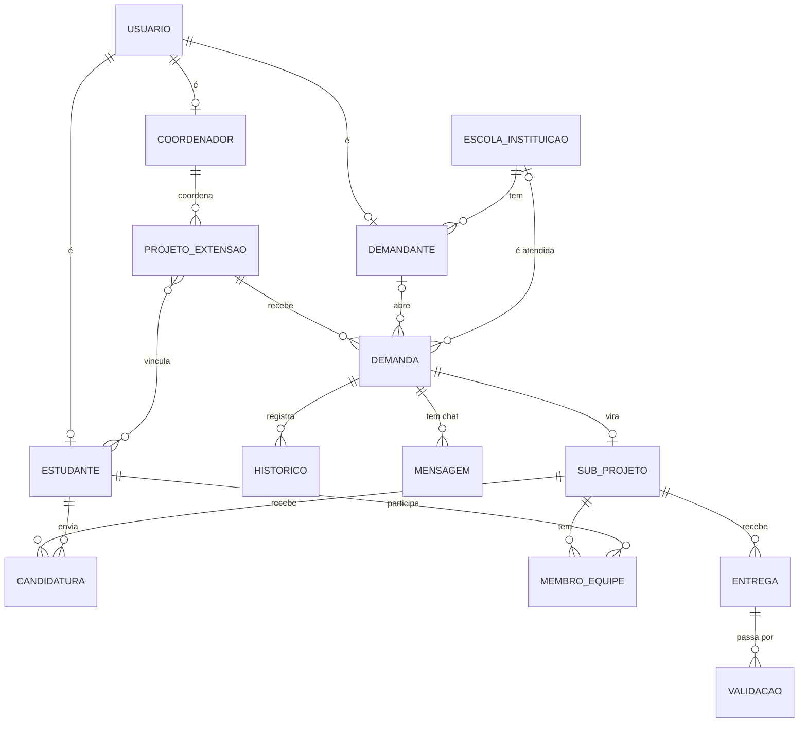
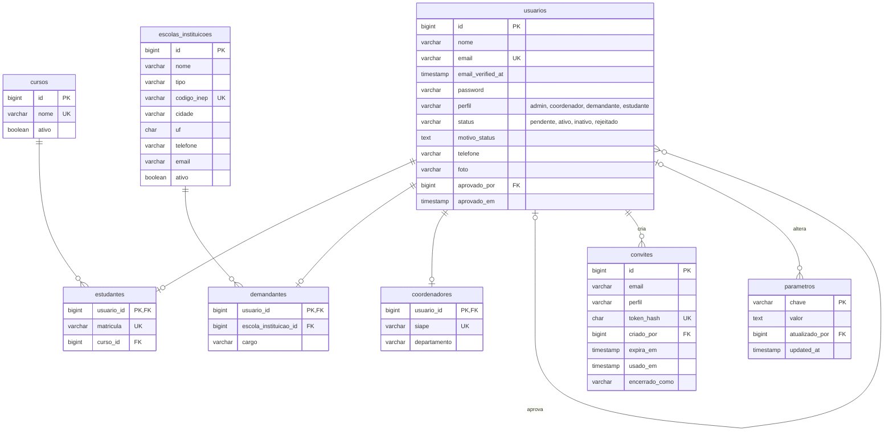
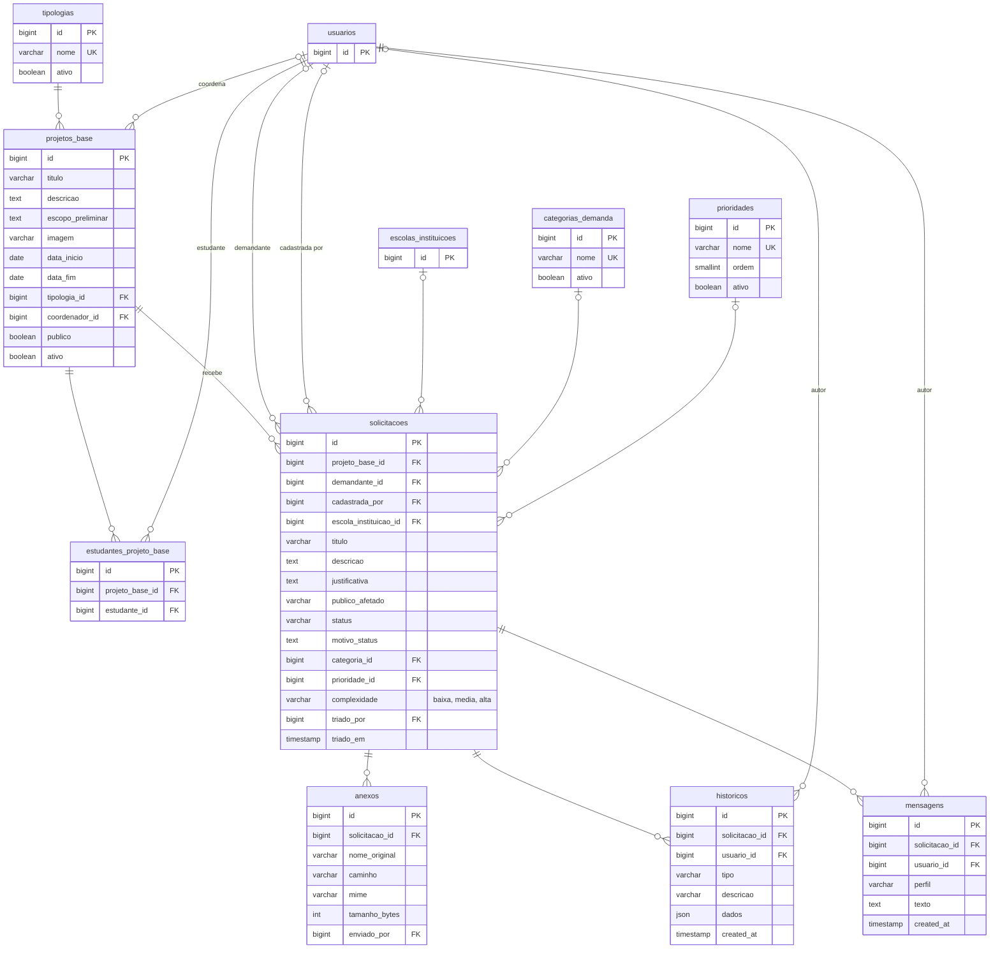
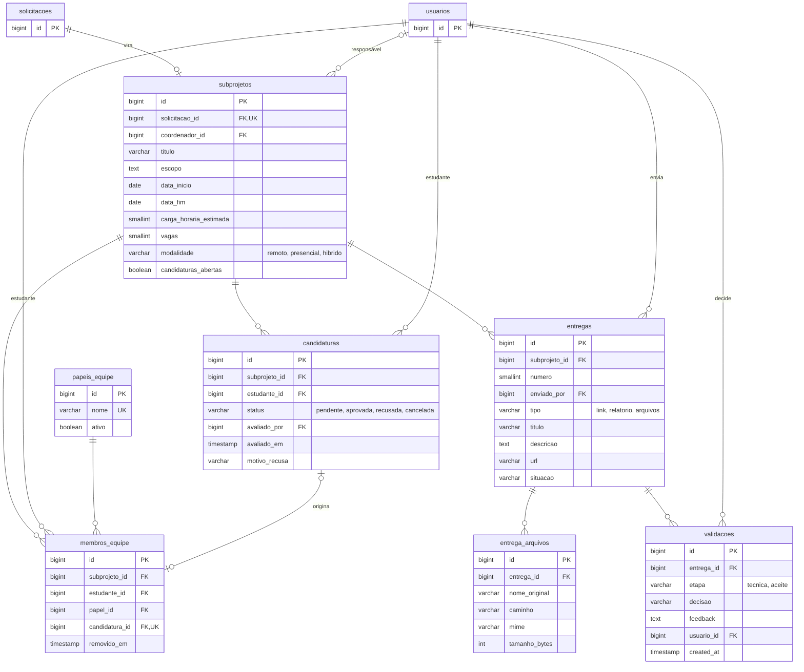

# Modelo de dados (DER) — Plataforma de Gestão de Demandas Tecnológicas

Modelo de dados do sistema, revisado na Fase 0 (2026-10-18) e conferido com as migrations em 1º de novembro de 2026 (Fases 0 a 9).

Os diagramas estão em [Mermaid](https://mermaid.js.org/): o GitHub mostra os desenhos nesta página, e o [Mermaid Live Editor](https://mermaid.live) exporta cada um em PNG ou SVG para o texto do TCC.

**Convenções**
- Banco MySQL/MariaDB, `utf8mb4`. Nomes de tabelas e colunas em português, no plural e em `snake_case`.
- Colunas padrão do Laravel mantidas em inglês: `id`, `created_at`, `updated_at`, `password`, `remember_token`, `email_verified_at`.
- Listas fixas (status, perfil, modalidade, complexidade) ficam em colunas `string` validadas por *Enums* do PHP. Listas que o admin pode ampliar ficam em tabelas de domínio (RF17).
- Toda chave estrangeira tem índice. Exclusões usam `restrict` por padrão: registros com histórico não são apagados, são inativados.

**Números:** 24 tabelas do sistema, mais as tabelas padrão do Laravel (`password_reset_tokens`, `sessions`, `cache`, `jobs`, `failed_jobs`).

---

## 1. Visão conceitual

As entidades principais e como se ligam, sem os atributos. É o diagrama indicado para a apresentação.

Leitura das cardinalidades: `||` exatamente um · `|o` zero ou um · `o{` zero ou muitos.

- Um **usuário** tem um perfil e, conforme o perfil, os dados de estudante, demandante ou coordenador.
- Um **projeto de extensão** tem um coordenador e vários estudantes vinculados, e recebe várias demandas.
- Uma **demanda** pode não ter demandante nem comunidade/instituição, quando a coordenação a abre em nome de uma comunidade/instituição sem ninguém cadastrado.
- Cada demanda vira **no máximo um sub-projeto**, que tem a equipe e as entregas.
- Cada **entrega** passa por validações: técnica (coordenação) e aceite (demandante).

---

## 2. Diagramas lógicos (com atributos)

O modelo completo dividido em três áreas, para cada figura caber numa página. As tabelas que aparecem em mais de uma área estão repetidas só com a chave.

### 2.1 Usuários e cadastros

### 2.2 Projetos de extensão e demandas

### 2.3 Sub-projetos, equipe e entregas

---

## 3. Dicionário de dados

### 3.1 Usuários e cadastros (Fase 1)

**`usuarios`** — uma linha por pessoa que acessa o sistema.

| Coluna | Tipo | Regras |
|---|---|---|
| id | bigint PK | |
| nome | varchar(150) | obrigatório |
| email | varchar(150) | obrigatório, único; é o login |
| email_verified_at | timestamp | nulo até confirmar o e-mail (estudante); preenchido no cadastro do demandante e no convite |
| password | varchar(255) | hash (bcrypt) |
| perfil | varchar(20) | `admin`, `coordenador`, `demandante`, `estudante` |
| status | varchar(20) | `pendente`, `ativo`, `inativo`, `rejeitado`; padrão `pendente` |
| motivo_status | text | obrigatório ao rejeitar ou inativar |
| telefone | varchar(20) | opcional; obrigatório para demandante |
| foto | varchar(255) | nulo; caminho da foto de perfil no disco `local` (Fase 9); sem foto, a tela usa o avatar padrão do perfil |
| aprovado_por | FK `usuarios` | nulo; quem aprovou |
| aprovado_em | timestamp | nulo |
| remember_token, created_at, updated_at | | padrão Laravel |

**`estudantes`** (1:1 com `usuarios`)

| Coluna | Tipo | Regras |
|---|---|---|
| usuario_id | PK, FK `usuarios` | |
| matricula | varchar(20) | obrigatório, único |
| curso_id | FK `cursos` | obrigatório |

**`demandantes`** (1:1 com `usuarios`)

| Coluna | Tipo | Regras |
|---|---|---|
| usuario_id | PK, FK `usuarios` | |
| escola_instituicao_id | FK `escolas_instituicoes` | obrigatório |
| cargo | varchar(100) | obrigatório (texto livre) |

**`coordenadores`** (1:1 com `usuarios`)

| Coluna | Tipo | Regras |
|---|---|---|
| usuario_id | PK, FK `usuarios` | |
| siape | varchar(20) | opcional, único |
| departamento | varchar(150) | opcional |

**`escolas_instituicoes`**

| Coluna | Tipo | Regras |
|---|---|---|
| id | bigint PK | |
| nome | varchar(200) | obrigatório |
| tipo | varchar(30) | `escola_publica`, `escola_privada`, `instituicao`, `outro` |
| codigo_inep | varchar(8) | opcional, único |
| cidade | varchar(100) | obrigatório |
| uf | char(2) | obrigatório |
| telefone, email | | opcionais |
| ativo | boolean | padrão `true`; a comunidade/instituição digitada no cadastro do demandante nasce `false` e é ativada pelo admin na conferência |

**`cursos`** — `id`, `nome` (varchar(150), único), `ativo`. Seeder com os 16 cursos do campus de Alegre.

**`convites`** — convite do admin para o Coordenador projeto de extensão (RF16).

| Coluna | Tipo | Regras |
|---|---|---|
| id | bigint PK | |
| email | varchar(150) | obrigatório, com índice |
| perfil | varchar(20) | hoje só `coordenador` |
| token_hash | char(64) | único; SHA-256 do token; o token puro só vai no e-mail |
| criado_por | FK `usuarios` | admin |
| expira_em | timestamp | 7 dias depois do envio |
| usado_em | timestamp | nulo até ser usado; uso único |
| encerrado_como | varchar(15) | nulo; `cancelado` ou `substituido` quando o convite é encerrado antes do prazo (Fase 9) |

**`parametros`** — parâmetros gerais (RF20, Fase 7).

| Coluna | Tipo | Regras |
|---|---|---|
| chave | varchar(50) PK | |
| valor | text | nulo |
| atualizado_por | FK `usuarios` | nulo; quem alterou |
| updated_at | timestamp | |

A lista de parâmetros, os valores padrão e as descrições ficam no código (model `Parametro`). A tabela guarda só os valores que o admin alterou.

Tabelas padrão do Laravel que continuam: `password_reset_tokens`, `sessions`, `cache`, `jobs` (fila dos avisos por e-mail) e `failed_jobs`.

### 3.2 Projetos de extensão e domínios (Fase 2)

**`tipologias`**, **`categorias_demanda`**, **`papeis_equipe`** — `id`, `nome` (varchar(100), único), `ativo`. Seeders: 6 tipologias, 7 categorias; papéis Membro Desenvolvedor, Responsável Técnico, Apoio de Campo e Outros.

**`prioridades`** — `id`, `nome` (único), `ordem` (smallint, para ordenar a fila; menor primeiro), `ativo`. Seeder: Urgente, Alta, Média, Baixa.

**`projetos_base`** — o projeto de extensão (RF05).

| Coluna | Tipo | Regras |
|---|---|---|
| id | bigint PK | |
| titulo | varchar(150) | obrigatório |
| descricao | text | obrigatório |
| escopo_preliminar | text | opcional |
| imagem | varchar(255) | nulo; caminho da imagem do projeto no disco `local` (Fase 9); sem imagem, a tela usa o fundo padrão |
| data_inicio | date | obrigatório |
| data_fim | date | opcional; ≥ `data_inicio` |
| tipologia_id | FK `tipologias` | obrigatório |
| coordenador_id | FK `usuarios` | perfil `coordenador`; nulo no "Demandas Gerais" até o admin definir e quando o coordenador é inativado ou muda de perfil (Fase 9) |
| publico | boolean | padrão `true`; aparece na página pública (RF14) |
| ativo | boolean | padrão `true`; só ativos recebem demandas |

Seeder: Projeto Base **"Demandas Gerais"** (decisão da Fase 0).

**`estudantes_projeto_base`** — estudantes extensionistas vinculados ao projeto (RF22, Fase 9).

| Coluna | Tipo | Regras |
|---|---|---|
| id | bigint PK | |
| projeto_base_id | FK `projetos_base` | exclusão em cascata |
| estudante_id | FK `usuarios` | perfil `estudante`, status `ativo` no momento do vínculo |
| created_at, updated_at | timestamp | |
| | | **único** (`projeto_base_id`, `estudante_id`) |

Só os vinculados entram nas equipes dos sub-projetos do projeto, pela coordenação ou por candidatura. Na criação da tabela, quem já tinha participado de uma equipe foi vinculado ao projeto dela.

### 3.3 Demandas (Fases 3 e 4)

**`solicitacoes`** — a demanda (RF06 e RF07).

| Coluna | Tipo | Regras |
|---|---|---|
| id | bigint PK | |
| projeto_base_id | FK `projetos_base` | obrigatório |
| demandante_id | FK `usuarios` | perfil `demandante`; nulo quando a coordenação abre a demanda sem demandante (Fase 9) |
| cadastrada_por | FK `usuarios` | quem registrou: o demandante, o coordenador ou o admin (Fase 9) |
| escola_instituicao_id | FK `escolas_instituicoes` | copiado do demandante na abertura, para os relatórios não mudarem se ele trocar de comunidade/instituição; escolhida pela coordenação quando ela abre a demanda, ou nulo se ela não informar (Fase 9) |
| titulo | varchar(100) | obrigatório |
| descricao | text | obrigatório |
| justificativa | text | obrigatório |
| publico_afetado | varchar(255) | obrigatório |
| status | varchar(30) | `cadastrada`, `em_analise`, `priorizada`, `em_desenvolvimento`, `em_validacao`, `aguardando_ajustes`, `concluida`, `recusada`, `cancelada`; mudança sempre manual |
| motivo_status | text | obrigatório para `recusada` e `cancelada` |
| categoria_id | FK `categorias_demanda` | nulo até a triagem |
| prioridade_id | FK `prioridades` | nulo até a triagem |
| complexidade | varchar(10) | `baixa`, `media`, `alta`; nulo até a triagem |
| triado_por | FK `usuarios` | nulo |
| triado_em | timestamp | nulo |

**`anexos`** — arquivos da abertura da demanda (PDF/JPG/PNG; quantidade e tamanho definidos nos parâmetros, padrão 5 arquivos de 5 MB).

| Coluna | Tipo | Regras |
|---|---|---|
| id | bigint PK | |
| solicitacao_id | FK `solicitacoes` | |
| nome_original | varchar(255) | |
| caminho | varchar(255) | dentro de `storage/app/private`, com nome aleatório |
| mime | varchar(100) | |
| tamanho_bytes | int unsigned | |
| enviado_por | FK `usuarios` | |

**`historicos`** — linha do tempo da demanda (RF08; só inclusão, nunca edição).

| Coluna | Tipo | Regras |
|---|---|---|
| id | bigint PK | |
| solicitacao_id | FK `solicitacoes` | |
| usuario_id | FK `usuarios` | quem fez; nulo só se a mudança não veio de um usuário logado (ex.: comando de manutenção) |
| tipo | varchar(30) | `status`, `triagem`, `subprojeto`, `carga_horaria`, `equipe`, `entrega`, `validacao`, `outro` |
| descricao | varchar(255) | texto exibido na linha do tempo |
| dados | json | detalhes, ex.: `{"de": 40, "para": 60}` para carga horária ou `{"de": "priorizada", "para": "em_desenvolvimento"}` |
| created_at | timestamp | |

**`mensagens`** — chat da demanda (RF08): `id`, `solicitacao_id`, `usuario_id`, `perfil` (perfil do autor no momento do envio), `texto` (até 2.000 caracteres), `created_at`. Não é editada nem apagada.

### 3.4 Sub-projetos e equipe (Fase 5)

**`subprojetos`** — a demanda em execução (RF09; 1:1 com `solicitacoes`).

| Coluna | Tipo | Regras |
|---|---|---|
| id | bigint PK | |
| solicitacao_id | FK `solicitacoes` | **único** |
| coordenador_id | FK `usuarios` | responsável: o coordenador que criou; se o admin criou, o coordenador do Projeto Base (ou o admin, se o projeto não tiver coordenador); nulo ("a definir pela administração") quando o coordenador é inativado ou muda de perfil com a demanda em andamento (Fase 9) |
| titulo | varchar(150) | pré-preenchido da demanda |
| escopo | text | obrigatório |
| data_inicio | date | obrigatório |
| data_fim | date | obrigatório; ≥ `data_inicio`; pode ser corrigida depois do encerramento |
| carga_horaria_estimada | smallint unsigned | horas; editável em qualquer status pelo admin ou coordenador; cada mudança gera `historicos.tipo = carga_horaria` |
| vagas | smallint unsigned | mínimo 1; nunca abaixo dos membros ativos |
| modalidade | varchar(15) | `remoto`, `presencial`, `hibrido` |
| candidaturas_abertas | boolean | controle manual do coordenador; a equipe completa também tira o sub-projeto da vitrine, sem mudar esta coluna |

O Projeto Base do sub-projeto vem de `solicitacoes.projeto_base_id`. Não há uma coluna repetida em `subprojetos`, para os dois valores nunca ficarem diferentes.

**`candidaturas`** (RF10 e RF11)

| Coluna | Tipo | Regras |
|---|---|---|
| id | bigint PK | |
| subprojeto_id | FK `subprojetos` | |
| estudante_id | FK `usuarios` | perfil `estudante`, status `ativo`, vinculado ao Projeto Base |
| status | varchar(15) | `pendente`, `aprovada`, `recusada`, `cancelada` |
| avaliado_por | FK `usuarios` | nulo |
| avaliado_em | timestamp | nulo |
| motivo_recusa | varchar(500) | opcional; o estudante vê o motivo (Fase 9) |
| | | **único** (`subprojeto_id`, `estudante_id`); quem cancelou se candidata de novo na mesma linha, que volta a `pendente` |

**`membros_equipe`** (RF11)

| Coluna | Tipo | Regras |
|---|---|---|
| id | bigint PK | |
| subprojeto_id | FK `subprojetos` | |
| estudante_id | FK `usuarios` | |
| papel_id | FK `papeis_equipe` | |
| candidatura_id | FK `candidaturas` | único; nulo se o membro foi incluído direto pela coordenação |
| removido_em | timestamp | nulo; remoção sem apagar o histórico. Quem volta à equipe reaproveita a mesma linha (Fase 9) |
| | | **único** (`subprojeto_id`, `estudante_id`) |

Regra: membros ativos (`removido_em` nulo) ≤ `subprojetos.vagas`. A aprovação trava a linha do sub-projeto para garantir isso.

O sub-projeto recebe candidaturas (vitrine RF10 e página pública RF14) quando `candidaturas_abertas` é verdadeiro, há vagas livres, a demanda não está `concluida`, `cancelada` ou `recusada` e o Projeto Base está ativo (e `publico`, na página pública).

### 3.5 Entregas e validação (Fase 6)

**`entregas`** (RF12)

| Coluna | Tipo | Regras |
|---|---|---|
| id | bigint PK | |
| subprojeto_id | FK `subprojetos` | |
| numero | smallint unsigned | ordem da entrega no sub-projeto (1, 2, 3...) |
| enviado_por | FK `usuarios` | membro ativo da equipe, ou o coordenador/admin em nome da equipe |
| tipo | varchar(20) | `link`, `relatorio`, `arquivos` |
| titulo | varchar(150) | obrigatório |
| descricao | text | opcional |
| url | varchar(500) | obrigatório quando `tipo = link`; só `http://` ou `https://` |
| situacao | varchar(25) | `aguardando_tecnica`, `devolvida`, `aguardando_aceite`, `pendencia`, `aceita`; acompanha a última validação |
| created_at, updated_at | timestamp | |

**`entrega_arquivos`** — arquivos da entrega: `id`, `entrega_id`, `nome_original`, `caminho`, `mime`, `tamanho_bytes`, `created_at`, `updated_at`. Aceita PDF, DOCX, XLSX, XLS, JPG, PNG e ZIP (o relatório técnico aceita só PDF, DOCX e Excel). Quantidade e tamanho definidos nos parâmetros (padrão 5 arquivos de 20 MB). Os arquivos ficam no disco `local`, fora da pasta pública.

**`validacoes`** (RF13)

| Coluna | Tipo | Regras |
|---|---|---|
| id | bigint PK | |
| entrega_id | FK `entregas` | |
| etapa | varchar(15) | `tecnica` (coordenação) ou `aceite` (demandante; o admin ou o coordenador podem registrar em nome dele) |
| decisao | varchar(20) | técnica: `aprovada` / `devolvida`; aceite: `aceita` / `pendencia` |
| feedback | text | obrigatório quando `devolvida` ou `pendencia` |
| usuario_id | FK `usuarios` | quem decidiu |
| created_at | timestamp | só inclusão: a validação não é editada nem apagada |

### 3.6 Relatório e dashboard

O **relatório por extensionista (RF15)** e o **dashboard (RF18)** não têm tabelas próprias:
- o RF15 consulta `membros_equipe` → `subprojetos` → `solicitacoes` → `projetos_base` / `escolas_instituicoes`, com `data_inicio`, `data_fim` e `carga_horaria_estimada` do sub-projeto;
- o RF18 calcula os tempos médios pelos registros de `historicos`.

### 3.7 Trabalho futuro

**`logs_auditoria`** (logins e alterações administrativas) foi planejada na Fase 0, mas não foi criada, por escolha do autor na Fase 7. A linha do tempo (`historicos`) registra as ações sobre cada demanda.

---

## 4. Mudanças em relação ao DER do documento original

| Mudança | Motivo |
|---|---|
| `PROFESSOR_ORIENTADOR` virou `coordenadores`, e entraram `estudantes` e `demandantes` (1:1 com `usuarios`) | Cada perfil guarda só os seus dados, sem colunas vazias |
| `id_gestor` virou `demandante_id`, que aceita nulo, e entrou `cadastrada_por` | O perfil passou a se chamar Demandante, e a coordenação também abre demandas |
| Tabela `PROJETO_TIPOLOGIA` virou `tipologias`, e saiu a coluna `natureza_tipologia` repetida | A tipologia fica só na tabela de domínio |
| `SOLICITACAO.anexos` virou a tabela `anexos` | Uma demanda pode ter vários arquivos |
| Entraram `complexidade`, `motivo_status`, `triado_por` e os status `em_validacao`, `aguardando_ajustes`, `recusada`, `cancelada` em `solicitacoes` | Triagem completa (RF07) e ciclo de status decidido na Fase 0 |
| Tabelas novas `subprojetos`, `candidaturas`, `papeis_equipe`, `membros_equipe`, `entregas`, `entrega_arquivos`, `validacoes` | RF09 a RF13, que o DER original não cobria |
| Tabelas novas `convites`, `cursos`, `parametros`, `estudantes_projeto_base` | RF16, RF01, RF20 e RF22 |
| `solicitacoes.escola_instituicao_id` | Os relatórios continuam corretos se o demandante trocar de comunidade/instituição |
| `subprojetos` sem `projeto_base_id` próprio | O valor vem da solicitação; evita inconsistência |
| `membros_equipe.removido_em` | Remover alguém da equipe não apaga o histórico de participação |
| `projetos_base.publico`, `ativo` e `imagem` | Página pública (RF14), projetos encerrados e imagem de divulgação |
| `historicos.dados` (json) | Guarda o valor anterior e o novo, inclusive das mudanças de carga horária |

## 5. Pontos confirmados pelo autor (2026-10-18)

1. **Comunidade/instituição no cadastro do demandante:** o demandante escolhe a comunidade/instituição em uma lista; se não encontrar, digita uma nova, que o admin confere junto com a aprovação do cadastro.
2. **Membro removido no relatório (RF15):** quem foi removido da equipe **não** aparece no relatório daquele sub-projeto.
3. **Papéis da equipe:** começar com Membro Desenvolvedor, Responsável Técnico e Apoio de Campo; o admin cadastra outros (depois entrou "Outros", na Fase 9).
4. **Página pública (RF14):** todo Projeto Base ativo aparece por padrão; o coordenador pode ocultá-lo desmarcando `publico`.
