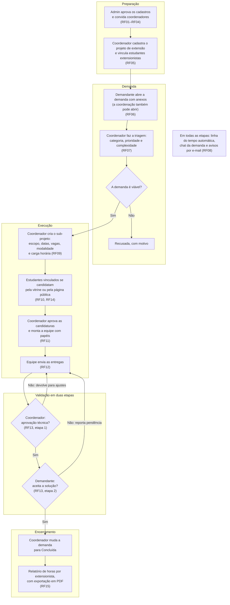
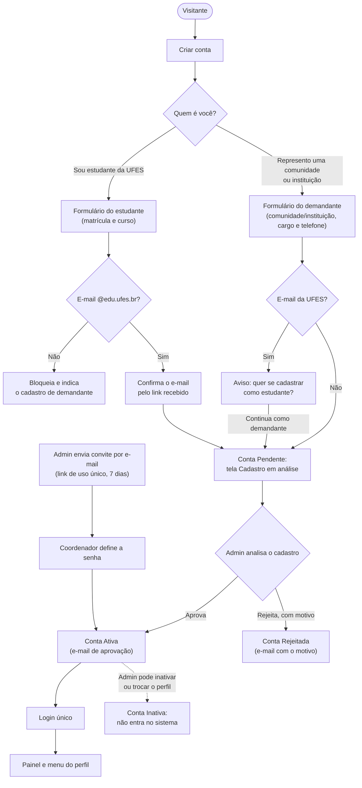
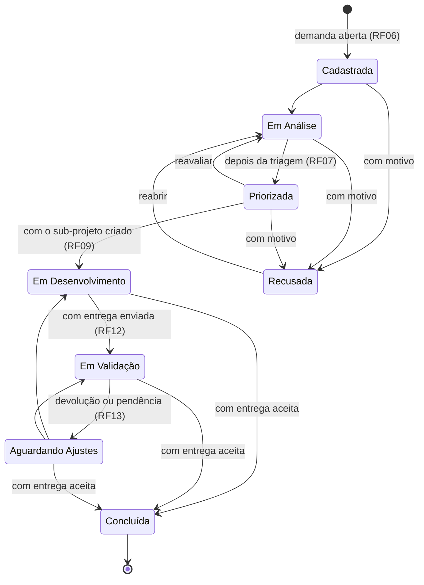
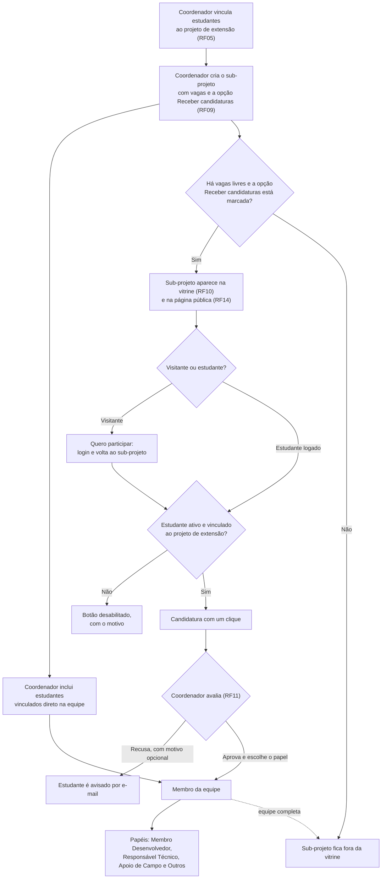
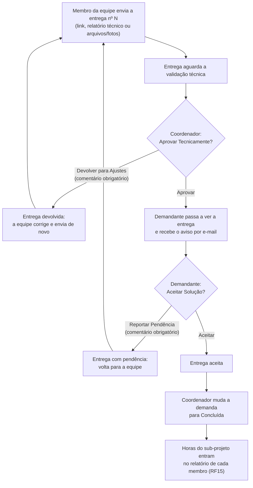

# Fluxogramas do sistema — PGDT

Plataforma de Gestão de Demandas Tecnológicas, do projeto de extensão "Rede de Apoio Tecnológico às Escolas" (UFES/CCENS — Alegre-ES).

Os diagramas estão em [Mermaid](https://mermaid.js.org/): o GitHub mostra os desenhos direto nesta página, e o [Mermaid Live Editor](https://mermaid.live) exporta cada um em PNG ou SVG para o texto do TCC.

Eles descrevem o sistema como está implementado (Fases 0 a 9, novembro de 2026).

**Perfis:** Administrador · Coordenador projeto de extensão · Demandante (comunidade/instituição) · Estudante Extensionista · Visitante (sem login)

**Termos:**
- **Projeto de extensão (Projeto Base):** a linha de extensão cadastrada pela coordenação (RF05).
- **Demanda (solicitação):** o pedido de uma comunidade ou instituição, sempre ligado a um projeto de extensão (RF06).
- **Sub-projeto:** a demanda priorizada que vira trabalho de uma equipe de estudantes (RF09).

---

## 1. Visão geral

O caminho de uma demanda, da abertura ao relatório de horas. Cada caixa indica quem faz a ação e o requisito.

---

## 2. Cadastro e acesso (RF01 a RF04)

Cada perfil entra por um caminho próprio, para ninguém escolher o perfil errado. O login é um só para todos.

---

## 3. Ciclo de status da demanda

Todas as mudanças são manuais e feitas pelo coordenador ou pelo admin. Ao criar o sub-projeto, enviar uma entrega ou registrar o aceite, a tela sugere o próximo status. Cada mudança vai para a linha do tempo, com quem mudou e quando.

**Cancelada** (com motivo) fica fora do desenho para ele não ficar poluído:
- o demandante cancela a própria demanda enquanto ela está Cadastrada, Em Análise ou Priorizada;
- o admin cancela em qualquer status, menos Concluída e Recusada (uma demanda concluída cancelada tiraria as horas dos estudantes do relatório).

---

## 4. Equipe do sub-projeto (RF09, RF10, RF11 e RF14)

O estudante só entra na equipe de um sub-projeto se estiver vinculado ao projeto de extensão dele.

---

## 5. Entrega e validação em duas etapas (RF12 e RF13)

Cada entrega é numerada e avaliada separadamente. A equipe pode enviar novas entregas enquanto a demanda está em execução.

Se a comunidade/instituição não tem demandante no sistema, a coordenação registra o aceite ou a pendência em nome dela. A linha do tempo mostra essa informação.
