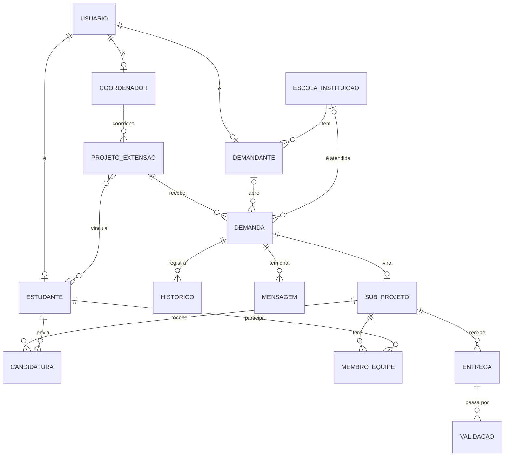

**RF01 - Cadastro Acadêmico:** O sistema disponibiliza um formulário de registro próprio para o corpo discente, realizando a validação estrita do e-mail inserido para aceitar exclusivamente o domínio institucional de estudante @edu.ufes.br.

- **Campos Disponíveis:** Nome Completo (texto obrigatório), E-mail Institucional (@edu.ufes.br), Matrícula (numérico obrigatório e único), Curso (lista suspensa com pesquisa), Telefone (opcional, com máscara), Senha e Confirmação de Senha.
- **Regra de Negócio:** O sistema cria a conta com o perfil "Estudante Extensionista" e envia um link de confirmação de e-mail. Após a confirmação, a conta fica com o status "Pendente" até a aprovação do Administrador; nesse período, o estudante visualiza apenas a tela "Cadastro em análise". E-mails de fora do domínio são recusados, com indicação do cadastro institucional. A senha deve ter no mínimo 8 caracteres, com letras e números.
- **Permissões:** Acesso público para novos usuários acadêmicos.

**RF02 - Cadastro Institucional (Comunidade/Escolas):** Porta de entrada exclusiva para solicitantes externos vinculados à comunidade.

- **Campos Disponíveis:** Nome Completo, E-mail de Contato, Escola / Instituição (lista suspensa com pesquisa ou, em "Não encontrei minha escola", nome, tipo, cidade e UF da nova escola), Cargo / Função (texto livre), Telefone / WhatsApp com máscara (obrigatório), Senha e Confirmação de Senha.
- **Regra de Negócio:** O sistema gera a conta com o perfil de "Demandante" e define o status inicial como "Pendente" para moderação. A escola informada manualmente fica pendente de conferência pelo Administrador. Caso o e-mail informado seja da UFES, o sistema pergunta se o usuário deseja se cadastrar como estudante.
- **Permissões:** Acesso público para novos usuários da comunidade.

**RF03 - Acesso e Recuperação de Credenciais:** Funcionalidade de login seguro via e-mail e senha, contemplando um fluxo autônomo para recuperação de credenciais.

- **Parâmetros Disponíveis:** Tela de autenticação única com e-mail e senha; tela de solicitação de recuperação via envio de link temporário por e-mail; e tela de redefinição contendo os campos de nova senha e confirmação.
- **Regra de Negócio:** O perfil de acesso é definido pela conta do usuário. O login é bloqueado temporariamente após 5 tentativas incorretas. Contas com status "Pendente" acessam apenas a tela "Cadastro em análise"; contas "Inativa" ou "Rejeitada" não acessam o sistema e visualizam o motivo informado pelo Administrador.
- **Permissões:** Acesso geral para usuários cadastrados na plataforma.

**RF04 - Administração de Usuários:** Painel restrito para o gerenciamento global de contas e moderação de acessos.

- **Parâmetros Disponíveis:** Tela de listagem com filtros de busca por Nome, E-mail, Perfil e Status; tela de detalhes do usuário com opções para aprovar ou rejeitar o cadastro, alterar o status da conta (Ativo, Inativo, Pendente, Rejeitado), trocar o perfil de acesso, editar os dados cadastrais (nome, telefone, matrícula, curso, escola, cargo, SIAPE e departamento) e conferir a escola informada no cadastro.
- **Regra de Negócio:** Somente contas com status "Ativo" utilizam o sistema. A rejeição e a inativação exigem motivo e confirmação. A troca de perfil exibe o perfil atual e o novo antes de salvar; ao inativar ou trocar o perfil de um Coordenador, os projetos sob sua responsabilidade passam para a administração. O e-mail não é alterado pelo Administrador, por ser o login do usuário.
- **Permissões:** Acesso restrito e exclusivo ao perfil Administrador.

**RF05 - Cadastro de Projetos de Extensão (Projetos Base):** Funcionalidade na qual o Coordenador Projeto de Extensão ou o Administrador cadastra previamente as iniciativas ou linhas de extensão oferecidas pela universidade.

- **Parâmetros Disponíveis:** Título do projeto, descrição, escopo preliminar, data de início, data de término prevista, seleção da **Tipologia do Projeto**, coordenador responsável, imagem do projeto (opcional), estudantes extensionistas vinculados e as opções "Ativo" (recebe demandas) e "Público" (exibido na consulta pública).
- **Regra de Negócio:** Estabelece a iniciativa extensionista base para orientar a comunidade. O Coordenador que cadastra o projeto torna-se o responsável; apenas o Administrador escolhe ou altera o coordenador. Os projetos não são excluídos: ao desmarcar "Ativo", o projeto deixa de receber demandas. O projeto "Demandas Gerais" recebe as solicitações que não se enquadram nos demais.
- **Permissões:** Cadastro e edição restritos ao Coordenador Projeto de Extensão (somente os seus projetos) e ao Administrador.

**RF06 - Abertura de Solicitações (Demandas):** Área onde o Demandante seleciona um projeto de extensão pré-cadastrado na plataforma para registrar e formalizar a sua necessidade tecnológica.

- **Parâmetros Disponíveis:** Seleção do projeto de extensão, Título da Demanda (máximo de 100 caracteres), Descrição Detalhada do cenário atual e do problema, Justificativa da importância, Público Afetado e Anexos (área de *drag-and-drop* ou seleção de arquivos em PDF, JPG ou PNG, até 5 arquivos de 5 MB). Na abertura pela coordenação: seleção da escola/instituição e do demandante responsável (ambos opcionais).
- **Regra de Negócio:** A nova solicitação é vinculada diretamente à iniciativa extensionista escolhida, com o status "Cadastrada", iniciando o ciclo de atendimento institucional. A escola é obtida do cadastro do Demandante. Os anexos são armazenados fora da área pública do servidor. O Demandante acompanha as suas solicitações em "Minhas demandas" e pode cancelá-las, com motivo, até o início do desenvolvimento.
- **Permissões:** Demandante (para a própria escola), Coordenador Projeto de Extensão (nos projetos que coordena) e Administrador.

**RF07 - Triagem e Parametrização:** Fila de trabalho na qual o Coordenador analisa as novas demandas, classificando a categoria, a complexidade e definindo a prioridade de atendimento.

- **Parâmetros Disponíveis:** Fila de pendências contendo solicitações filtradas pelo status "Cadastrada", com filtros por título, status, prioridade e projeto. Visão de detalhes com exibição do título, descrição, justificativa, público afetado e anexos. Listas suspensas para selecionar a categoria, a prioridade e a complexidade (Baixa, Média, Alta).
- **Regra de Negócio:** O Coordenador avalia a solicitação recebida e aplica a classificação técnica necessária para estruturar o fluxo de atendimento, alterando o status para "Em Análise" e "Priorizada", ou "Recusada" mediante motivo informado ao Demandante. A classificação pode ser revista até a demanda ser priorizada. A fila é ordenada pela prioridade e pela data de abertura.
- **Permissões:** Acesso restrito ao Coordenador Projeto de Extensão (demandas dos seus projetos) e ao Administrador.

**RF08 - Rastreabilidade e Comunicação:** Histórico visual e canal de mensagens acoplado a cada demanda para garantir o acompanhamento transparente e a interação contínua entre a universidade e a comunidade.

- **Parâmetros Disponíveis:** Área de rastreabilidade contendo uma barra de progresso visual (estágios: Cadastrada, Em Análise, Priorizada, Em Desenvolvimento, Em Validação, Concluída) e um histórico de ações em formato de linha do tempo cronológica, registrado automaticamente. Área de comunicação contendo um fio de mensagens com autor, foto, perfil, data/hora e texto, além de campo de texto e botão "Enviar Comentário".
- **Regra de Negócio:** Centraliza o histórico de alterações de status, classificação, equipe, entregas, validações e carga horária, com o autor e a data de cada ação, e viabiliza o diálogo direto entre o Demandante e a coordenação. As mudanças de status são manuais, com sugestão do próximo status. O histórico e as mensagens não podem ser editados nem excluídos. O canal de mensagens fica disponível apenas para leitura após a conclusão ou o cancelamento da demanda.
- **Permissões:** Acesso restrito aos usuários envolvidos diretamente com a demanda (Demandante solicitante, Coordenador do projeto, estudantes da equipe e Administrador). Os estudantes não visualizam os contatos do Demandante.

**RF09 - Criação e Formalização de Sub-projetos:** Funcionalidade que permite ao Coordenador converter uma demanda priorizada em um sub-projeto do projeto de extensão, definindo o escopo técnico, os prazos e a equipe.

- **Parâmetros Disponíveis:** Título e Escopo (pré-preenchidos automaticamente a partir da demanda, com suporte à edição; escopo obrigatório), Data de Início, Data de Fim Prevista, Carga Horária Estimada, Número de Vagas, Modalidade (Remoto, Presencial ou Híbrido), opção "Receber candidaturas" e inclusão direta de estudantes vinculados ao projeto, além dos botões "Criar Sub-projeto" e "Cancelar".
- **Regra de Negócio:** O sistema cria o sub-projeto associado à demanda original (assumindo automaticamente o coordenador logado como responsável) e abre o canal para a captação de membros. A carga horária estimada e a data de término podem ser corrigidas em qualquer status, inclusive após a conclusão, com registro no histórico do valor anterior e do novo. O número de vagas não pode ser inferior ao número de membros da equipe.
- **Permissões:** Acesso restrito ao Coordenador Projeto de Extensão e ao Administrador.

**RF10 - Vitrine de Oportunidades:** Mural de sub-projetos visível aos Estudantes Extensionistas para consulta de iniciativas com vagas abertas e submissão de interesse com um clique.

- **Parâmetros Disponíveis:** Cartões (cards) exibindo o Título, resumo do escopo, projeto de extensão, **indicador visual da modalidade (Remoto, Presencial ou Híbrido)**, nome do coordenador, datas de execução, vagas e carga horária; barra de pesquisa; filtros por modalidade e por projeto; botão de candidatura; e área "Meus sub-projetos" com as equipes e a situação das candidaturas.
- **Regra de Negócio:** Permite que os estudantes filtrem e identifiquem sub-projetos que correspondem à sua disponibilidade e perfil técnico ou prático. São exibidos apenas os sub-projetos com candidaturas abertas, vagas livres e demanda em andamento, dos projetos de extensão aos quais o estudante está vinculado. O estudante pode cancelar a candidatura enquanto ela não for avaliada.
- **Permissões:** Acesso restrito e exclusivo ao perfil de Estudante Extensionista.

**RF11 - Gestão de Lotação da Equipe:** Painel para o Coordenador aprovar ou recusar as candidaturas dos alunos, designando formalmente os responsáveis técnicos pela execução.

- **Parâmetros Disponíveis:** Tabela de Solicitações Pendentes (botões "Aprovar" e "Recusar", com motivo opcional); Tabela de Equipe do Sub-projeto com lista suspensa de Papel ("Membro Desenvolvedor", "Responsável Técnico", "Apoio de Campo" ou "Outros") e opção de remoção.
- **Regra de Negócio:** Efetiva o vínculo do aluno na iniciativa e define as alocações de responsabilidade para a execução da tarefa. A aprovação respeita o número de vagas e exige o vínculo do estudante com o projeto de extensão. A remoção de um membro preserva o registro da sua participação.
- **Permissões:** Acesso restrito ao Coordenador responsável pelo sub-projeto e ao Administrador.

**RF12 - Submissão de Entregas:** Interface flexível para os Estudantes registrarem as atividades desenvolvidas, adaptando-se tanto a projetos de software quanto a iniciativas de manutenção física e suporte.

- **Parâmetros Disponíveis:** Título da Entrega, Descrição das Atividades e seletor de **Tipo de Entrega** (com opções dinâmicas para "Link/Repositório de Código", "Relatório Técnico" em PDF, DOCX ou Excel, ou "Arquivos e Fotos" em PDF, DOCX, Excel, JPG, PNG ou ZIP), acompanhado de zonas de upload (até 5 arquivos de 20 MB) ou campo de URL.
- **Regra de Negócio:** Permite o registro formal de entregas lógicas ou físicas, validando restrições de formato e tamanho de arquivos. Cada entrega é numerada na ordem de envio e avaliada separadamente. As entregas são aceitas com a demanda em "Em Desenvolvimento", "Em Validação" ou "Aguardando Ajustes".
- **Permissões:** Acesso restrito aos Estudantes que possuem vínculo aprovado na equipe do sub-projeto. O Coordenador e o Administrador podem registrar entregas em nome da equipe.

**RF13 - Validação e Aceite:** Fluxo de aprovação em etapas para aceitar tanto soluções de software quanto a execução de serviços presenciais e manutenções de hardware.

- **Parâmetros Disponíveis:** Painel da entrega submetida com o conteúdo, os arquivos e as decisões anteriores; caixa de comentário obrigatória para devolução e para pendência; botões de ação do Coordenador ("Aprovar Tecnicamente" e "Devolver para Ajustes"); e botões de ação do Demandante ("Aceitar Solução" para o aceite final do serviço/produto e "Reportar Pendência").
- **Regra de Negócio:** Estabelece o portão de qualidade institucional em duas etapas, permitindo que a escola ateste o recebimento e o funcionamento prático da demanda atendida. O Demandante visualiza a entrega somente após a aprovação técnica. A demanda só pode ser concluída com ao menos uma entrega aceita. Quando a escola confirma o aceite por outro meio ou não possui demandante cadastrado, a coordenação registra a decisão em seu nome, com indicação no histórico. As decisões não podem ser editadas nem excluídas.
- **Permissões:** Acesso restrito ao Coordenador e ao Administrador (avaliação técnica) e ao Demandante da escola solicitante (aceite final).

**RF14 - Consulta Pública de Projetos:** Página de acesso aberto, sem necessidade de login, com os projetos de extensão cadastrados e os sub-projetos com vagas abertas.

- **Parâmetros Disponíveis:** Lista de projetos de extensão em cartões, com imagem, pesquisa e filtros; tela de detalhes do projeto com os sub-projetos com vagas (título, escopo, coordenador, modalidade, período e vagas); e botão "Quero participar".
- **Regra de Negócio:** Exibe apenas dados públicos, sem contatos, anexos, mensagens ou fotos de usuários. O botão "Quero participar" direciona ao login e, após a autenticação, retorna ao sub-projeto para a candidatura. Apenas o Estudante Extensionista ativo e vinculado ao projeto pode se inscrever; para os demais, o botão é exibido desabilitado com o motivo. Projetos marcados como não públicos não são exibidos.
- **Permissões:** Acesso público.

**RF15 - Relatório de Demandas por Extensionista:** Relatório das demandas executadas por cada Estudante Extensionista, com o período e a carga horária de participação.

- **Parâmetros Disponíveis:** Seção por estudante com, para cada sub-projeto: título, projeto de extensão, escola/instituição, papel do estudante, data de início, data de fim e carga horária estimada, com o total de horas; filtros por estudante, período, projeto de extensão e status; e botão "Exportar PDF".
- **Regra de Negócio:** As datas e a carga horária são obtidas do sub-projeto, refletindo as correções realizadas pela coordenação. O filtro de período considera os sub-projetos iniciados e concluídos no intervalo. Membros removidos da equipe não são listados.
- **Permissões:** Administrador (todos os estudantes), Coordenador (estudantes das equipes dos seus projetos) e Estudante Extensionista (apenas o próprio relatório).

**RF16 - Cadastro de Coordenador por Convite:** Funcionalidade pela qual o Administrador convida o Coordenador Projeto de Extensão a ingressar na plataforma, sem autocadastro.

- **Parâmetros Disponíveis:** Tela de convites com o e-mail do convidado e a lista de convites com a situação (Válido, Usado, Expirado, Cancelado, Substituído); tela de aceite com Nome, Telefone, SIAPE e Departamento (opcionais), Senha e Confirmação de Senha.
- **Regra de Negócio:** O convite é enviado por e-mail, com link de uso único válido por 7 dias. Um novo convite para o mesmo e-mail substitui o anterior. A conta criada pelo convite recebe o perfil "Coordenador Projeto de Extensão" com o status "Ativo".
- **Permissões:** Envio e cancelamento restritos ao Administrador; aceite pelo destinatário do convite.

**RF17 - Cadastros de Apoio:** Manutenção das listas utilizadas nos formulários do sistema.

- **Parâmetros Disponíveis:** Tipologias de projeto, categorias de demanda, prioridades (com ordem de atendimento) e papéis da equipe, com as opções de incluir, renomear e ativar/inativar.
- **Regra de Negócio:** Os itens não são excluídos. O item inativado deixa de ser exibido nas listas de seleção, mas permanece nos registros que já o utilizam.
- **Permissões:** Acesso restrito e exclusivo ao perfil Administrador.

**RF18 - Dashboard Gerencial:** Painel com os indicadores do atendimento, para o acompanhamento e a prestação de contas do projeto de extensão.

- **Parâmetros Disponíveis:** Totais de demandas (em triagem, em execução e concluídas), tempo médio de atendimento, tempo médio da primeira resposta e gráficos por status, categoria, escola/instituição e projeto de extensão; filtros por período de abertura e por projeto.
- **Regra de Negócio:** Os tempos médios são calculados a partir do histórico das demandas. O Coordenador visualiza apenas as demandas dos seus projetos.
- **Permissões:** Acesso restrito ao Coordenador Projeto de Extensão e ao Administrador.

**RF19 - Avisos por E-mail:** Envio automático de avisos por e-mail sobre os acontecimentos de cada demanda, com acesso direto à tela correspondente.

- **Parâmetros Disponíveis:** Avisos de nova demanda, mudança de status, nova mensagem, nova candidatura, candidatura aprovada ou recusada, entrada na equipe, entrega enviada, aprovação técnica, entrega devolvida, aceite e pendência; além dos e-mails de confirmação de cadastro, aprovação, rejeição, convite e recuperação de senha.
- **Regra de Negócio:** Os avisos são enviados aos envolvidos na demanda, exceto ao autor da ação e às contas inativas. Demandas sem coordenador notificam os administradores. O envio é feito por fila, sem atrasar a operação do usuário. Os avisos podem ser desativados nos parâmetros gerais; os e-mails de cadastro permanecem ativos.
- **Permissões:** Envio automático pelo sistema.

**RF20 - Parâmetros Gerais:** Configurações gerais da plataforma, alteradas sem necessidade de mudança no código.

- **Parâmetros Disponíveis:** Nome da rede, e-mail de contato, ativação dos avisos por e-mail e quantidade e tamanho máximo dos anexos das demandas e dos arquivos das entregas.
- **Regra de Negócio:** Os limites de arquivos não podem ultrapassar os limites do servidor. Sem alteração, valem os valores padrão. O sistema registra o autor de cada alteração.
- **Permissões:** Acesso restrito e exclusivo ao perfil Administrador.

**RF21 - Meu Perfil:** Área na qual cada usuário mantém os próprios dados de acesso.

- **Parâmetros Disponíveis:** Aba "Meus dados" (nome, telefone e os dados do perfil: curso, cargo ou SIAPE e departamento); aba "Senha" (senha atual, nova senha e confirmação); e foto de perfil (enviar, trocar ou remover).
- **Regra de Negócio:** E-mail, perfil, status, matrícula e escola são alterados apenas pelo Administrador. A foto é recortada e regravada pelo sistema, removendo os metadados do arquivo; sem foto, é exibido um avatar padrão do perfil. A foto é exibida somente para usuários autenticados.
- **Permissões:** Usuários com conta ativa, apenas sobre a própria conta.

**RF22 - Vínculo de Estudantes ao Projeto de Extensão:** Definição dos Estudantes Extensionistas de cada projeto de extensão, aptos a participar dos seus sub-projetos.

- **Parâmetros Disponíveis:** Campo "Estudantes extensionistas vinculados" no cadastro e na edição do projeto de extensão, com seleção múltipla e pesquisa por nome, matrícula ou curso.
- **Regra de Negócio:** Apenas estudantes ativos podem ser vinculados. Os sub-projetos alocam somente estudantes vinculados ao projeto, seja por inclusão direta ou por candidatura. A desvinculação não remove o estudante das equipes das quais já participa. Os vínculos não são exibidos na consulta pública.
- **Permissões:** Acesso restrito ao Coordenador do projeto e ao Administrador.

**RNF01 - Usabilidade:** Interface em português do Brasil, com mensagens de erro junto ao campo; listas de seleção com pesquisa, sem diferenciar maiúsculas e acentos; botão "Voltar" padronizado; confirmação antes de ações irreversíveis; cadastros separados por perfil; e menu e painel inicial de acordo com o perfil do usuário.

**RNF02 - Responsividade:** As telas funcionam em celulares (a partir de 360 px), tablets e computadores, sem rolagem lateral. Em telas pequenas, as tabelas extensas são exibidas em cartões.

**RNF03 - Segurança:** Senhas armazenadas com hash (bcrypt), com no mínimo 8 caracteres, letras e números; bloqueio temporário do login após 5 tentativas incorretas; proteção contra falsificação de requisições (CSRF) em todos os formulários; limite de envios por minuto nos cadastros, candidaturas, entregas e mensagens; cabeçalhos de segurança e uso obrigatório de HTTPS em produção; e verificação do tipo dos arquivos enviados pelo conteúdo.

**RNF04 - Controle de Acesso por Perfil:** Todas as telas internas exigem autenticação, e-mail confirmado e conta ativa. Cada ação é autorizada conforme o perfil e o envolvimento do usuário com o registro, e os arquivos são disponibilizados apenas a quem pode visualizá-los.

**RNF05 - Privacidade (LGPD):** O sistema coleta apenas os dados necessários a cada perfil. As páginas públicas e a vitrine não exibem e-mail, telefone, matrícula ou fotos de usuários; os estudantes não visualizam os contatos do Demandante; as imagens enviadas são regravadas sem metadados; e o aviso de privacidade é disponibilizado no rodapé e nos formulários de cadastro.

**RNF06 - Rastreabilidade e Integridade dos Dados:** O histórico das demandas, as mensagens e as decisões das entregas não podem ser editados nem excluídos. Usuários, projetos e itens de apoio são inativados em vez de excluídos, e as alterações de status e de carga horária registram o autor e a data.

**RNF07 - Armazenamento de Arquivos:** Anexos, entregas, imagens e fotos são armazenados fora da pasta pública do servidor, com nomes aleatórios, e disponibilizados somente por rotas com verificação de permissão. Os limites de quantidade e tamanho são configuráveis pelo Administrador.

**RNF08 - Tecnologia e Manutenibilidade:** Sistema desenvolvido em PHP 8.3 com o framework Laravel 13 (arquitetura MVC), banco de dados MySQL/MariaDB e interface em Blade, Bootstrap 5 e JavaScript, com código versionado no GitHub, testes automatizados dos fluxos principais e das permissões, e envio de e-mails por fila.

## Diagrama Entidade-Relacionamento

